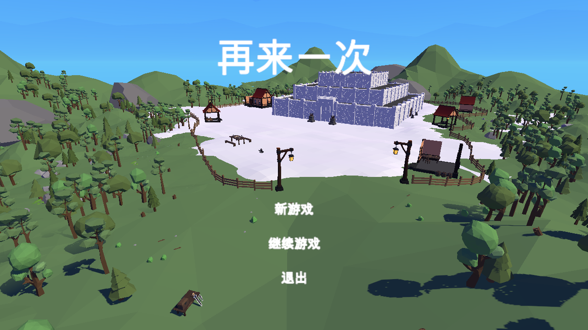
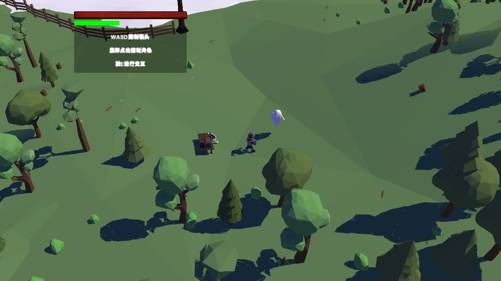
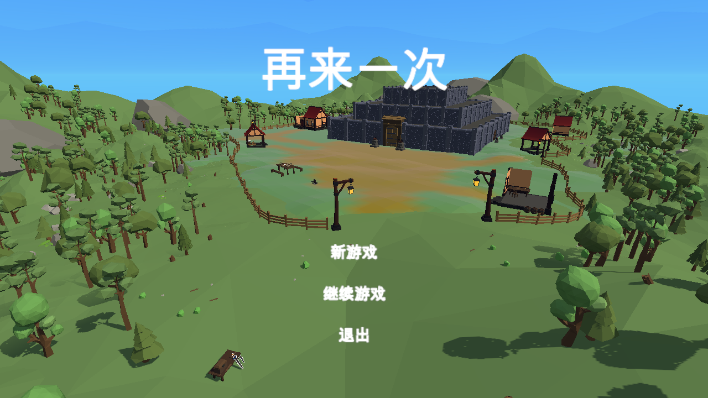

# Unity 6 资源恢复与运行修复

## 恢复依据

- 远程仓库：`https://github.com/xhy0303/GraduationProject`，重新核对仅有 `main`、`build`，没有另外的资源分支、标签或 Release。工程历史没有上传被忽略的 `Assets/AssetsPack`。
- 工程基线：`main` / `ee4c837e8888c7d9dea7f676dba4364f5a9a62e2`。
- 原始资源恢复来源：你自己的 Windows 成品，`build` / `c84dcea633c4510be88d8c2836c05b47f7e35702`。已核对该分支 LFS 文件大小和哈希。
- 目标编辑器：Unity `6000.5.10f1`。原版本为 `2022.3.55f1c1`。

不是用空物体填掉 Missing 引用：从成品恢复了 6 个完整场景、角色及敌人网格、动画、骨架、装备、物品数据、对话、音频、UI、碰撞体和导航数据。场景依赖闭包共导入 1,017 个恢复文件，放在 `Assets/Recovered`；场景保留原始场景路径和 GUID。已有源码继续使用仓库中的修复版本，没有用反编译代码覆盖游戏逻辑。

## 替代与限制

成品中的编译 Shader 不能直接作为可维护的 Unity 6 源码使用。优先复用仓库 ShaderGraph、当前 URP Shader 和 QuickOutline；少量丢失的卡通/顶点色 Shader 改用 URP Lit，天空盒改用 Unity Skybox/Cubemap。画面可能与原 Windows 成品有差别，玩法参数不因此改变。完整替换映射见 `resource-recovery-manifest.json`。

成品不能还原 FBX 原始建模文件和原始 Prefab 嵌套/变体关系；恢复的是可编辑的 Unity Mesh、Avatar、AnimationClip、Prefab 和场景对象。恢复场景经过展开，后续批量编辑应留意这一点。

原工程整体保存在 `Builds/BeforeResourceRepair`；原 Windows 成品在 `Builds/Windows`；未经修改的资源导出在 `Builds/RecoveredOriginal`。没有删除这些备份。旧调试场景 Test 不属于发布流程，随原工程备份保留，不再作为当前工程启动场景。

## 修复范围

延续 10 月 7 日记录中的依赖升级、旧 API 兼容、中文源码编码修复和 QuickOutline 恢复，追加：

- 所有恢复脚本引用映射回现有源码及当前 Unity 包，未导入成品中的旧 DLL 或占位 Shader。
- 光标贴图恢复 Cursor 导入设置：可读、透明、无 mipmap、无压缩。
- 镜像建筑 BoxCollider 转为同位置同范围的正缩放子碰撞体；宝箱负尺寸改为引擎原本采用的绝对尺寸。
- SettingMenu、GameOverManager 随所属场景 UI 创建/销毁，移除对非根对象无效的 DontDestroyOnLoad 调用。
- 钥匙没有药水配置，双击不应按药水消耗；SlotHolder 仅对带有使用效果数据的消耗品应用回血和扣数量，钥匙开门/开箱逻辑保持原样。

## 已验证的场景资源

| 场景 | 对象 | 缺失脚本 | 缺失 MeshFilter 网格 | 缺失材质/Shader | 碰撞体 | NavMesh 顶点 |
|---|---:|---:|---:|---:|---:|---:|
| Begin | 4901（修复前审计） | 0 | 0 | 0 | 2061 | 33460 |
| Main | 5418（修复前审计） | 0 | 0 | 0 | 2082 | 33460 |
| Dungon | 658 | 0 | 0 | 0 | 345 | 151 |
| FirstFloor | 1460 | 0 | 0 | 0 | 834 | 1281 |
| SecondFloor | 1006 | 0 | 0 | 0 | 446 | 637 |
| ThirdFloor | 567 | 0 | 0 | 0 | 163 | 138 |

镜像碰撞体修复会增加少量子对象，不改变碰撞体数量。Unity 实际加载了全部场景；全资产 GUID 扫描为 0 个缺失引用。测试副本使用独立公司名/产品名隔离 PlayerPrefs，测试中新建游戏不会清空你的真实存档。

## 验证记录

- 隔离编译和场景审计：`Logs/resource-candidate-import.log`、`Logs/resource-candidate-prepare.log`。
- 运行测试通过的步骤：菜单新游戏、保存、返回、继续、兽人/隐形切换、全部 5 个游戏场景切换及玩家在 NavMesh 上、胜负面板、通关存档返回 Main。
- 实际画面由 Unity 渲染输出，检查角色、地图和材质；不是生成示意图。
- 25 种物品、12 个场景对话对象、点击移动、攻击动画事件扣血：实际运行通过，诊断为 0 错误、0 警告（`Logs/resource-gameplay-checks-2.log`）。
- 主工程已同步，打开 Begin 场景；编辑器当前 Console 为 0 错误、0 警告。
- 正式打包发现并移除了 PlayerController/GameManager 未使用的旧 `UnityEngine.Experimental.Rendering.Universal` 命名空间引用，解决仅在 Player 编译时出现的 CS0234。
- 传送门 ShaderGraph 为正数参数 powerScale 增加 Absolute 节点；当前材质值为 10，结果保持不变，避免 Metal 对 pow 负底数的警告。

测试中遇到的无图形渲染错误经正常图形模式复测不再出现；首次搜索索引异常是自动化在索引创建前进入 Play Mode 导致，测试先完成索引初始化后解决，不通过关闭游戏日志掩盖错误。

## 最终结果（2026-10-08）

- 主工程已完成同步。实际打开的 Unity 编辑器在 Begin 运行 20 秒，0 错误、0 警告；最终检查时用户打开的是 ThirdFloor，Console 同样为 0 错误、0 警告。
- 最后一次完整场景运行验证：15 个步骤通过，0 错误、0 警告。覆盖新建游戏、保存/继续、变身、所有游戏场景切换/导航、胜负面板及通关后的继续。
- 额外交互验证：25 种物品、12 个场景对话对象、移动和攻击，共 39 项记录通过，0 错误、0 警告。不是穷尽所有对话分支、战斗时序或完整人工通关。
- macOS 构建成功：0 错误、0 警告，约 373 MiB。成品位置：`Builds/Mac/OneMoreTime.app`。构建成功已验证；未用自动化覆盖该独立成品的完整通关过程。
- 主工程扫描 963 个序列化资源，缺失 GUID 数量为 0。
- 最终报告及证据保存在 `Docs/Review/RepairValidation/`；原始详细日志在 `Logs/`。
- 主工程当前脚本与隔离测试副本一致；没有提交或推送 Git。

本次同步前另保留了 `Builds/BeforeResourceSync-20261008`，包含同步当时的 Assets、Packages、ProjectSettings。测试源码在 `Tools/Recovery`，不会编入正式游戏。

本轮户外修正前，城堡外墙在截图中有表面纹理/明暗异常；检查了 Begin 中 2,608 个静态渲染对象，重复静态子网格范围为 0、越界范围为 0，后续定位到调色贴图映射遗漏，现已修正（见下方户外更新）。卡通 Shader 与当前 URP 的着色风格仍不能保证完全一致。

### 实际运行截图

## 户外画面修正（20:30 后更新）

用户指出城堡应位于草地上，原先白色地面与蓝紫色光照并非预期效果。已完成以下修正：

- 恢复 Polybrush 包自带的 `Lit Vertex Color URP` ShaderGraph。城堡周围 Plane 网格的 6,449 个顶点均有原始颜色，绿色草地和土路已实际渲染恢复，没有用纯绿色材质覆盖细节。
- 将 Gray_Gradient、Color 原 Shader 的 `_Texture` 调色贴图接到 URP `_BaseMap`，并恢复原色调参数；补回 ProBuilder 的标准顶点色 Shader。
- 仅修改 Begin/Main 的环境光为中性三色渐变，保留太阳方向、强度、实际投影；其他关卡光照不变。逐对象比较确认场景只修改了 RenderSettings。
- 编辑器从任意场景点 Play 时统一从 Begin 初始化管理器，退出运行后仍回到原编辑场景，避免直接从 Main 点 Play 时缺少管理器产生空引用。
- 原光照与材质保存在 `Builds/BeforeOutdoorVisualRepair-20261008`。

验收截图和日志见 `Docs/Review/OutdoorVisualValidation`。本轮还观察到旧测试存档跨编辑器进程的物品实例引用失效，这是原有 JSON 存档方式的独立问题；此次仅修改画面和编辑器运行入口，没有改写用户存档或存档格式。视觉验收使用独立测试命名空间的新游戏。

户外修正最终验证：新游戏进入 Main、城堡入口导航、菜单与城堡视角实际渲染，捕获的运行错误/警告均为 0。主编辑器从 Main 发起 Play 后正确进入 Begin，退出返回 Main；Console 为 0 错误、0 警告。更新后的 macOS 构建成功，0 错误、0 警告（`Logs/outdoor-mac-build.log`）。

